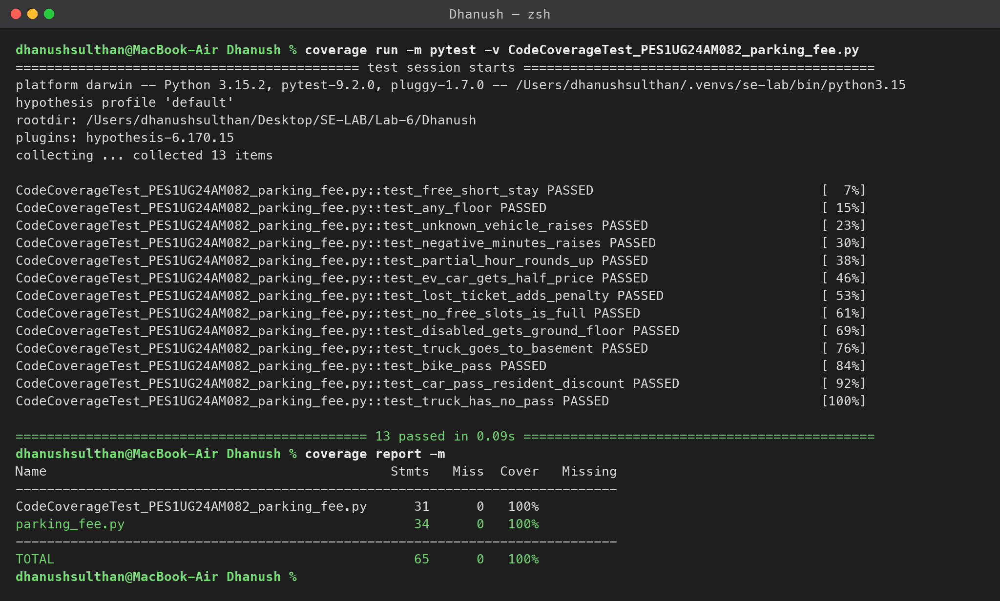
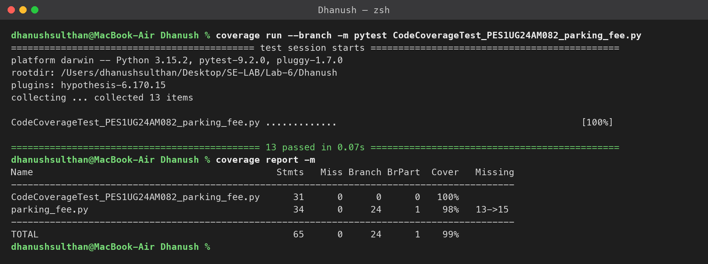
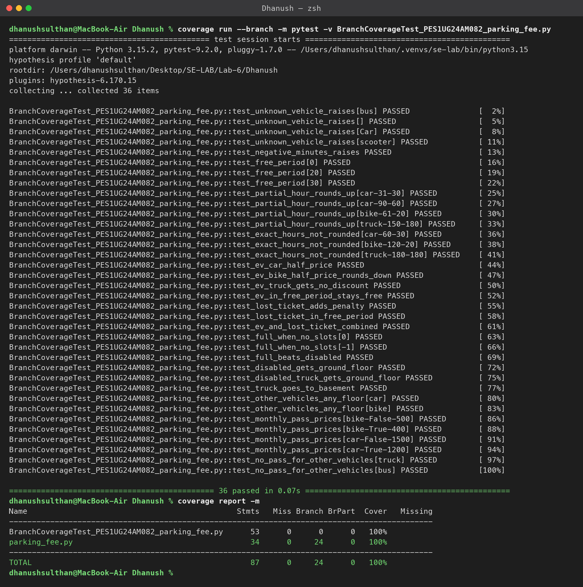
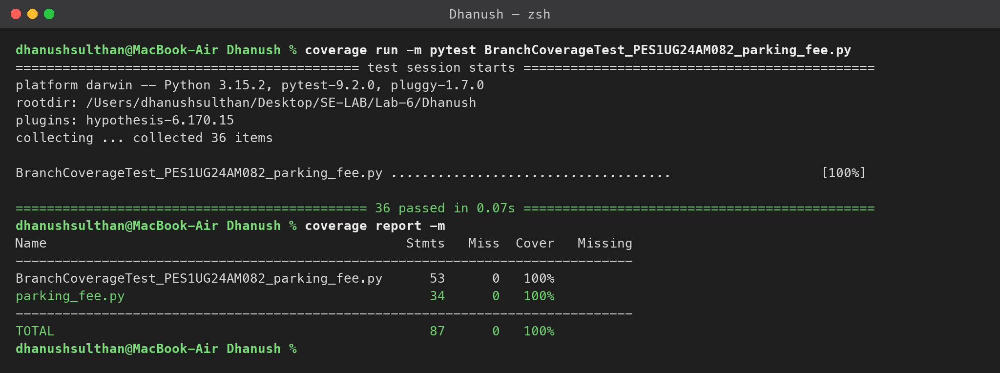

# Lab 6: Code and Branch Coverage — Parking Fee

**Name:** Dhanush S S | **SRN:** PES1UG24AM082 | **Section:** B
**Assigned repo:** [SETAPESU26/L6_L7_19_parking_fee](https://github.com/SETAPESU26/L6_L7_19_parking_fee)

## Files

| File | Description |
|------|-------------|
| `parking_fee.py` | Module under test (unchanged from the assigned repo) |
| `test_parking_fee.py` | Original starter test file (2 tests) |
| `CodeCoverageTest_PES1UG24AM082_parking_fee.py` | Test cases for code (line) coverage — 13 tests |
| `BranchCoverageTest_PES1UG24AM082_parking_fee.py` | Test cases for branch coverage — 36 tests |
| `screenshots/` | Terminal output of the coverage runs |

## Results for `parking_fee.py`

| Test file | Line coverage | Branch coverage |
|-----------|---------------|-----------------|
| `test_parking_fee.py` (starter) | 44% | 40% (8 partial branches) |
| `CodeCoverageTest_...py` | **100%** | 98% (missing `13->15`) |
| `BranchCoverageTest_...py` | **100%** | **100%** |

## Commands

```bash
pip install coverage pytest

# Code (line) coverage
coverage run -m pytest CodeCoverageTest_PES1UG24AM082_parking_fee.py
coverage report -m

# Branch coverage
coverage run --branch -m pytest BranchCoverageTest_PES1UG24AM082_parking_fee.py
coverage report -m
```

## Screenshots

**1. Code coverage tests — line coverage (100%)**



**2. Code coverage tests under branch measurement (98%, missing `13->15`)**



**3. Branch coverage tests — branch coverage (100%)**



**4. Branch coverage tests — line coverage (100%)**



## Analysis: line coverage vs branch coverage

The code coverage test file runs **every line** of `parking_fee.py`, so line coverage is 100%. Branch coverage still reports one partial branch, `13->15`:

```python
hours = minutes // 60
if minutes % 60 != 0:   # line 13
    hours += 1          # line 14
fee = hours * HOURLY_RATE[vehicle]   # line 15
```

Every paid-parking test used a duration with leftover minutes (for example 90), so the `if` on line 13 was only ever **True**. The jump straight from line 13 to line 15, taken when the stay is an exact number of hours, never happened. Line coverage cannot see this, because the `if` has no `else` line that could be counted as missed.

The branch coverage test file adds cases for every decision outcome:

- **Exact hours** (60, 120, 180 minutes): the `minutes % 60 != 0` False path, which is the missing `13->15`.
- **Free-period boundary** (0, 30 minutes vs 31 minutes): both sides of `minutes <= 30`.
- **EV truck:** `is_ev` is True but the vehicle is a truck, so the compound condition is False and no discount is applied.
- **EV + lost ticket together:** the penalty is added after the discount.
- **`find_slot` ordering:** a full lot beats a disabled driver, and a disabled driver beats the truck rule.
- **`monthly_pass`:** bike/car × resident/non-resident, plus the error path for truck or bus.

With these added, all 24 branches in the module are taken, giving 100% branch coverage.
